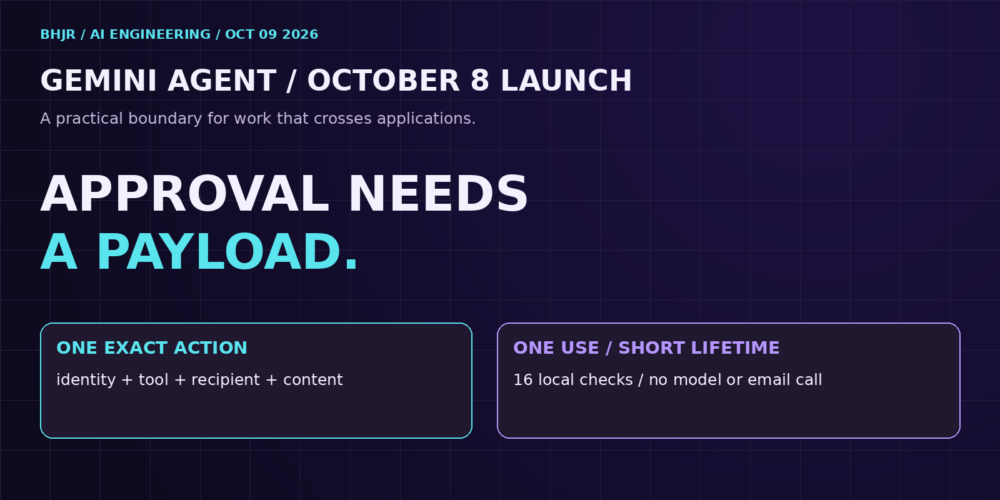

# Payload-bound approval



A tiny TypeScript teaching build inspired by Google's October 8, 2026 Gemini agent announcement. A task-only approval accepts an edited recipient. A payload-bound grant rejects it.

Article: publication link will be added after DEV verification.

## Run

Prerequisites: Git and Node.js 22.18 or later. Verified on Node.js 22.20.0. No dependencies, API keys, model calls or outbound email.

```bash
git clone https://github.com/bobbyhalljr/payload-bound-approval.git
cd payload-bound-approval
node demo.ts
```

Node uses native TypeScript type stripping. The command runs runtime assertions, not a TypeScript type check.

## What's here

- `approval.ts`: explicit runtime schema, versioned SHA-256 action fingerprint, trusted in-memory grants, expiry and single-use consumption.
- `demo.ts`: synthetic internal/external recipient fixtures and sixteen assertions.
- `tested-output.txt`: exact output.
- `images/`: cover and three diagrams.
- `article.md`: long-form explanation.

## Exact output

```text
PASS task-only approval accepts an edited recipient
PASS field insertion order does not change fingerprint
PASS exact approved action is allowed
PASS second use is denied
PASS edited recipient is denied
PASS edited body is denied
PASS different actor is denied
PASS different tenant is denied
PASS different tool is denied
PASS different task is denied
PASS expiry boundary is denied
PASS unknown grant is denied
PASS invalid clock is denied
PASS returned action is frozen and independent
PASS undeclared bcc field is denied
PASS non-string payload is denied
16 checks passed; synthetic fixtures; no model or email call.
```

## Boundaries and limitations

This is a single-process fixture, not a Gemini integration or production security system. Trusted approval creation is represented by a method with no authentication. Production requires authenticated actor/tenant context, an exact review UI, unguessable grant IDs, trusted time, revocation, durable atomic claims and full adapter schema validation. The adapter must dispatch the frozen returned action unchanged. Hashing does not establish authority or content safety. The narrow runtime validator expects inert JSON-like values, not getters or proxies. It rejects fields outside the seven-field schema, including BCC.

One-use grant consumption is not exactly-once remote execution. Pair it with durable dispatch state, idempotency and reconciliation. There is no model or email call and no measured benchmark.

## Primary references

- [Google's October 8 Gemini agent announcement](https://cloud.google.com/blog/products/ai-machine-learning/welcome-to-gemini-at-work-2026)
- [Node.js crypto.createHash](https://nodejs.org/docs/latest-v22.x/api/crypto.html#cryptocreatehashalgorithm-options)

MIT licensed. By Bobby Hall Jr.
